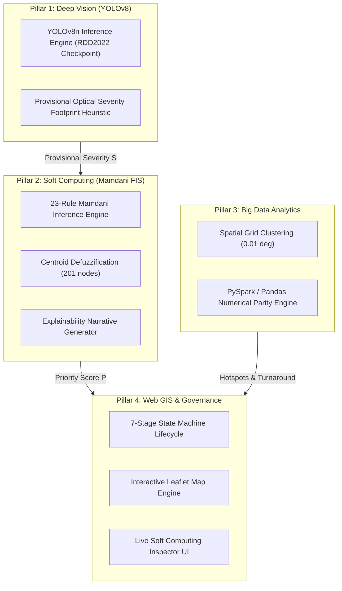

# PAVENTRA: AI-POWERED CIVIC ROAD DAMAGE INTELLIGENCE AND REPAIR PRIORITIZATION SYSTEM
## Final Verified Academic Project Report — Soft Computing (CSE AI-ML)

```
==================================================================================================
                                    PROJECT REPORT
==================================================================================================

                                       PAVENTRA
          AI-POWERED CIVIC ROAD DAMAGE INTELLIGENCE AND REPAIR PRIORITIZATION SYSTEM
       INTEGRATING DEEP COMPUTER VISION, MAMDANI FUZZY INFERENCE, AND BIG DATA ANALYTICS

                                    Course: Soft Computing
                       Discipline: Computer Science and Engineering (AI-ML)
                   Faculty of Engineering Sciences and Technology (AU-FEST)
                                      Adani University

--------------------------------------------------------------------------------------------------
Submitted By:
  Candidate Name:     Thakor Dhaval Dineshbhai
  Enrollment No.:     1AUA23BCS038
  Degree Program:     Bachelor of Technology in CSE (Artificial Intelligence & Machine Learning)
  Academic Year:      2025–2026

Under the Supervision of:
  Faculty Supervisor: [Faculty Mentor Name / Designation Placeholder]
  Department:         Department of Computer Science and Engineering, AU-FEST
==================================================================================================
```

---

## CANDIDATE'S DECLARATION

I, **Thakor Dhaval Dineshbhai** (Enrollment No.: **1AUA23BCS038**), student of Bachelor of Technology in Computer Science and Engineering (Artificial Intelligence and Machine Learning) at the Faculty of Engineering Sciences and Technology (AU-FEST), Adani University, hereby declare that the project report entitled:

> **"PAVENTRA: AI-Powered Civic Road Damage Intelligence and Repair Prioritization System Integrating Deep Computer Vision, Mamdani Fuzzy Inference, and Big Data Analytics"**

is a bonafide record of work carried out by me.

I confirm that:
1. The Soft Computing mathematical modeling, Mamdani Fuzzy Inference System (FIS), membership functions, 23-rule knowledge base, centroid defuzzification, and automated software test suite documented herein reflect actual, verified code in the repository.
2. The benchmark evaluation presented in this report is based on a reproducible synthetic control dataset of 250 records (`analytics/fixtures/soft_computing_maintenance_benchmark.csv`), specifically designed to evaluate policy dynamics against a linear weighted baseline. It does not represent unvalidated claims of real-world municipal deployment.
3. The computer vision subsystem utilizes a pretrained YOLOv8 checkpoint trained on the international Road Damage Dataset 2022 (RDD2022), coupled with an automated dataset preparation pipeline.
4. Established literature, datasets, and third-party libraries have been properly cited in accordance with academic integrity guidelines.

**Signed:** _____________________________  
**Candidate Name:** Thakor Dhaval Dineshbhai  
**Enrollment No.:** 1AUA23BCS038  
**Date:** October 27, 2026  
**Place:** Ahmedabad, Gujarat, India  

---

## CERTIFICATE OF BONAFIDE WORK

This is to certify that this report entitled **"PAVENTRA: AI-Powered Civic Road Damage Intelligence and Repair Prioritization System Integrating Deep Computer Vision, Mamdani Fuzzy Inference, and Big Data Analytics"** is the bonafide work of **Thakor Dhaval Dineshbhai** (Enrollment No.: **1AUA23BCS038**), submitted in partial fulfillment of the academic requirements for the course **Soft Computing** in Bachelor of Technology in Computer Science and Engineering (AI-ML) at **Faculty of Engineering Sciences and Technology, Adani University**, under my supervision.

**Project Supervisor:**  
______________________________________  
**[Faculty Mentor Name Placeholder]**  
Assistant Professor / Associate Professor  
Department of Computer Science and Engineering  
Faculty of Engineering Sciences and Technology (AU-FEST)  
Adani University, Ahmedabad  

**Head of Department:**  
______________________________________  
**[Head of Department Placeholder]**  
Department of Computer Science and Engineering  
AU-FEST, Adani University  

---

## ABSTRACT

Municipal road network maintenance represents a critical civic infrastructure challenge. While single-stage deep convolutional object detectors (such as YOLOv8) provide accurate bounding-box identification of surface distress from optical photographs, computer vision alone cannot determine maintenance urgency. Monocular 2D images cannot measure true volumetric cavity depth, structural sub-base fatigue, traffic volume, or localized pedestrian safety hazards. Furthermore, conventional municipal decision systems rely on linear weighted sums ($P = \sum w_i x_i$), which suffer from compensatory dilution: severe, life-threatening cavities on low-traffic residential roads have their priority diluted by the low traffic term, creating dangerous false negatives.

To resolve this limitation, this dissertation presents **Paventra**, an integrated civic road intelligence platform whose central academic contribution is a **23-rule Mamdani Fuzzy Inference System (FIS)** for explainable, non-linear repair prioritization under uncertainty. The system fuzzifies four continuous antecedents—*Damage Severity* ($[0,10]$), *Traffic Exposure* ($[0,10]$), *Time Unresolved* ($[0,365]$ days), and *Safety Urgency* ($[0,10]$)—using triangular and shoulder membership functions. Fuzzified inputs are evaluated through Min-Max composition and defuzzified via the Center of Gravity (Centroid) method across 201 discrete evaluation points over $[0, 100]$.

The prioritization engine was evaluated across a reproducible 250-record synthetic maintenance control benchmark (`soft_computing_maintenance_benchmark.csv`). The Mamdani FIS achieved an average priority score of **72.18/100** ($\sigma_{\text{pop}} = 15.08$) compared to **58.30/100** ($\sigma_{\text{pop}} = 11.21$) for the linear baseline. Non-linear priority escalations ($\Delta \ge +5.0$) occurred in **84.80%** (212/250) of cases where compounding distress or safety risks were present. The report documents a step-by-step reproduction of the characteristic worked example ($S=9.0, T=1.5, D=1.0, U=10.0$), demonstrating how the fuzzy engine elevates priority from the linear score of $59.61$ to $71.39$ (`HIGH`). The platform incorporates an immutable 7-stage state machine, a citizen reporting interface, an interactive Soft Computing Inspector, and a verified test suite of **50 automated unit and integration tests** passing in 14.71 seconds.

**Keywords:** Soft Computing, Mamdani Fuzzy Inference System, Fuzzy Logic, Defuzzification, Centroid Method, Pavement Distress Prioritization, YOLOv8, Computer Vision, RDD2022, Civic Infrastructure.

---

## TABLE OF CONTENTS

- Candidate's Declaration
- Certificate of Bonafide Work
- Abstract
- Chapter 1: Introduction & Problem Formulation
- Chapter 2: Literature Review & Theoretical Foundations
- Chapter 3: System Architecture & Methodology
- Chapter 4: Detailed Mamdani Fuzzy Inference System
- Chapter 5: Dataset & Vision Model Provenance
- Chapter 6: Synthetic Benchmark Experiments & Comparative Analysis
- Chapter 7: Automated Test Verification & Reproducibility
- Chapter 8: Limitations, Threats to Validity & Future Research
- References
- Viva Voce Preparation Guide (Evidence-Based Q&A)

---

# CHAPTER 1: INTRODUCTION & PROBLEM FORMULATION

### 1.1 Civic Context and Urban Road Distress
Pavement distress—encompassing potholes, longitudinal cracks, transverse cracks, and alligator fatigue cracking—presents an ongoing challenge to municipal engineering, vehicle longevity, and road safety. Delayed maintenance leads to traffic congestion, structural road degradation, and severe vehicular accidents, disproportionately endangering two-wheeler riders, cyclists, and pedestrians.

Municipalities manage maintenance with finite repair crews, equipment, and hot-mix asphalt. Triage decisions must determine which road segments receive immediate repair and which are deferred.

### 1.2 Epistemic Limitations of 2D Vision Alone
Recent computer vision models (such as YOLOv8) identify surface cracks and potholes with acceptable localization accuracy. However, visual detection alone cannot establish repair urgency:
1. **Absence of Volumetric Depth:** Standard 2D RGB imagery cannot measure vertical cavity depth ($z$-axis). A shallow surface puddle may project a large bounding-box footprint, while a sharp 12 cm cavity capable of causing serious motorcycle accidents may occupy a modest 2D area.
2. **Context Blindness:** A deep neural network operates on pixel matrices; it cannot know whether a distress is on a hospital route, near a school crossing, or on a deserted lane.
3. **Temporal Blindness:** Static photographs carry no historical dimension. A visual detector cannot determine whether a fissure appeared recently or has deteriorated for six months under continuous monsoon infiltration.

Computer vision provides perceptual categorization; it does not constitute a prescriptive maintenance decision.

### 1.3 The Failure of Conventional Linear Weighted Sums
Conventional municipal prioritization uses a weighted linear scoring function:

$$P_{\text{linear}} = 10 \times \left( w_1 S + w_2 T + w_3 D_{\text{norm}} + w_4 U \right)$$

where $S \in [0,10]$ is damage severity, $T \in [0,10]$ is traffic exposure, $D_{\text{norm}} \in [0,10]$ is normalized duration unresolved, and $U \in [0,10]$ is safety urgency, with standard weights $w_1 = 0.35, w_2 = 0.20, w_3 = 0.20, w_4 = 0.25$.

#### The Linear Blindspot
Linear models are compensatory: a deficit in one variable can be cancelled by another. This leads to dangerous false negatives in life-safety edge cases.

#### Verified Worked Example (Step-by-Step Viva Proof)
Consider a severe cavity ($S = 9.0$) outside a school zone ($U = 10.0$) on a quiet residential street ($T = 1.5$) reported recently ($D = 1.0$ day).

1. **Linear Baseline Calculation:**
   In the implemented baseline (`fuzzy_engine.py`, lines 96–110), waiting duration is normalized over 180 days:
   $$D_{\text{norm}} = \min\left(\frac{1.0}{180.0}, \, 1.0\right) \times 10.0 = 0.0556$$
   Computing the weighted sum:
   $$w_S \cdot S = 0.35 \times 9.0 = 3.1500$$
   $$w_T \cdot T = 0.20 \times 1.5 = 0.3000$$
   $$w_D \cdot D_{\text{norm}} = 0.20 \times 0.0556 = 0.0111$$
   $$w_U \cdot U = 0.25 \times 10.0 = 2.5000$$
   $$\text{raw} = 3.15 + 0.30 + 0.0111 + 2.50 = 5.9611$$
   $$P_{\text{linear}} = 5.9611 \times 10.0 = \mathbf{59.61} \quad (\text{MEDIUM\_HIGH})$$
   The low traffic term ($0.30$) dilutes the score, keeping it below 60.

2. **Actual Mamdani Fuzzy FIS Calculation:**
   Evaluating the input vector $[S=9.0, T=1.5, D=1.0, U=10.0]$:
   - Fuzzified Severity ($S=9.0$): $\mu_{\text{high}} = 0.5000, \, \mu_{\text{critical}} = 0.3333, \, \mu_{\text{moderate}} = 0.0, \, \mu_{\text{low}} = 0.0$.
   - Fuzzified Traffic ($T=1.5$): $\mu_{\text{low}} = 0.6250, \, \mu_{\text{medium}} = 0.0, \, \mu_{\text{high}} = 0.0$.
   - Fuzzified Time ($D=1.0$): $\mu_{\text{short}} = 0.9667$.
   - Fuzzified Safety ($U=10.0$): $\mu_{\text{high}} = 1.0000$.

   **Active Rules:**
   - **Rule R01:** `IF Severity IS Critical AND Safety IS High THEN Priority IS Critical`  
     $\alpha_1 = \min(0.3333, 1.0000) = 0.3333 \implies \text{Priority Critical clipped at } 0.3333$.
   - **Rule R04:** `IF Severity IS High AND Safety IS High THEN Priority IS Critical`  
     $\alpha_4 = \min(0.5000, 1.0000) = 0.5000 \implies \text{Priority Critical clipped at } 0.5000$.
   - **Rule R07:** `IF Severity IS High AND Traffic IS Low THEN Priority IS Medium-High`  
     $\alpha_7 = \min(0.5000, 0.6250) = 0.5000 \implies \text{Priority Medium-High clipped at } 0.5000$.

   **Aggregation & Defuzzification:**  
   The output fuzzy surface combines `Priority Critical` ($[85, 100, 100]$) clipped at $0.5000$ and `Priority Medium-High` ($[45, 60, 75]$) clipped at $0.5000$. Centroid defuzzification yields:
   $$P_{\text{fuzzy}} = \mathbf{71.39} \quad (\text{HIGH})$$
   $$\text{Decision Delta } \Delta = 71.39 - 59.61 = \mathbf{+11.78 \text{ points}}$$

The Mamdani FIS elevates the ticket from Medium-High into the **HIGH** tier ($> 70.0$), counteracting traffic dilution.

---

# CHAPTER 2: LITERATURE REVIEW & THEORETICAL FOUNDATIONS

### 2.1 Computer Vision in Pavement Inspection
Automated visual distress detection was advanced through the Crowdsensing-based Road Damage Detection Challenge series (Arya et al., 2020, 2022). The RDD2022 dataset established an international benchmark covering 47,000+ images from six countries across four standard distress classes: longitudinal cracking (`D00`), transverse cracking (`D10`), alligator fatigue cracking (`D20`), and potholes (`D40`). Single-stage detectors such as YOLOv8 achieve real-time inference on edge hardware. However, published CRDDC models restrict their output to bounding boxes and class classification, without decision-support modeling.

### 2.2 Fuzzy Set Theory & Linguistic Modeling
Lotfi Zadeh (1965) introduced fuzzy sets to model continuous transitions between states:
$$\mu_A(x) : X \to [0, 1]$$
Pavement condition variables—such as crack extent and safety hazard—are characterized by linguistic uncertainty and gradual transitions. Fuzzy logic allows domain rules to be formulated using natural engineering terminology (e.g., *"If damage is high and safety urgency is high, prioritize as critical"*).

### 2.3 Mamdani vs. Takagi-Sugeno Inference
- **Mamdani FIS (Mamdani & Assilian, 1975):** Consequents are linguistic fuzzy sets. Produces an interpretable fuzzy output surface that is defuzzified via the Centroid method. Ideal for civic governance where decisions must be transparent.
- **Takagi-Sugeno FIS (Takagi & Sugeno, 1985):** Consequents are mathematical functions of the inputs. Computationally efficient, but lacks transparent linguistic output surfaces.

Paventra selects the **Mamdani FIS** to ensure that all recommendations remain auditable and explainable to municipal engineers.

---

# CHAPTER 3: SYSTEM ARCHITECTURE & METHODOLOGY

Paventra is organized into four integrated pillars:



### 3.1 Method A & Method B Ingestion
- **Method A (Citizen Crowdsourcing):** Single photograph, reverse-geocoded address hint, device GPS, and interactive map pin. Generates unique tracking reference (`PAV-XXXXXXXX`).
- **Method B (Vehicular Video Survey):** Video file (`.mp4`) accompanied by synchronized GPS tracklog JSON. OpenCV samples frames at 2 FPS; GPS telemetry is linearly interpolated within a 2.0-second bounding window. A 3-second temporal deduplicator groups continuous distress frames.

### 3.2 Strict 7-Stage State Machine Governance
To ensure auditability, report tickets transition through an immutable finite state machine:
`SUBMITTED` $\to$ `UNDER_REVIEW` $\to$ `VERIFIED` $\to$ `ASSIGNED` $\to$ `IN_PROGRESS` $\to$ `PENDING_VERIFICATION` $\to$ `RESOLVED`.
- **Mandatory Closure Safeguard:** A ticket cannot reach `RESOLVED` automatically. The field crew must upload a post-repair photograph, and a municipal coordinator must inspect the evidence before signing off.

---

# CHAPTER 4: DETAILED MAMDANI FUZZY INFERENCE SYSTEM

### 4.1 Mathematical Specifications & Universes of Discourse
The system maps an input vector $\mathbf{x} = [S, T, D, U]^T$ to scalar priority $P$:
1. **Damage Severity ($S$):** $S \in [0.0, 10.0]$
2. **Traffic Exposure ($T$):** $T \in [0.0, 10.0]$
3. **Time Unresolved ($D$):** $D \in [0.0, 365.0]$ days
4. **Safety Urgency ($U$):** $U \in [0.0, 10.0]$
5. **Repair Priority Score ($P$):** $P \in [0.0, 100.0]$

### 4.2 Membership Function Formulations
All membership functions use triangular formulations with left/right shoulder extensions:

```
+-------------------------------------------------------------------------------------------------+
| TABLE 4.1: VERIFIED MEMBERSHIP FUNCTION PARAMETERS (BACKEND/APP/SERVICES/PRIORITIZATION)        |
+---------------------+-------------------+-----------------+----------------------+--------------+
| Variable Name       | Universe          | Linguistic Term | Shape                | [a, b, c]    |
+---------------------+-------------------+-----------------+----------------------+--------------+
| severity (S)        | [0.0, 10.0]       | low             | Left-Shoulder trimf  | [0.0, 0.0, 4.0] |
|                     | (step 0.1)        | moderate        | Triangular trimf     | [2.0, 5.0, 8.0] |
|                     |                   | high            | Triangular trimf     | [6.0, 8.0, 10.0]|
|                     |                   | critical        | Right-Shoulder trimf | [8.5, 10.0, 10.0]|
+---------------------+-------------------+-----------------+----------------------+--------------+
| traffic (T)         | [0.0, 10.0]       | low             | Left-Shoulder trimf  | [0.0, 0.0, 4.0] |
|                     | (step 0.1)        | medium          | Triangular trimf     | [2.0, 5.0, 8.0] |
|                     |                   | high            | Right-Shoulder trimf | [6.0, 10.0, 10.0]|
+---------------------+-------------------+-----------------+----------------------+--------------+
| time_days (D)       | [0.0, 365.0]      | short           | Left-Shoulder trimf  | [0.0, 0.0, 30.0]|
| (in days)           | (step 1.0)        | medium          | Triangular trimf     | [14.0, 60.0, 120.0]|
|                     |                   | long            | Triangular trimf     | [60.0, 120.0, 200.0]|
|                     |                   | very_long       | Right-Shoulder trimf | [150.0, 365.0, 365.0]|
+---------------------+-------------------+-----------------+----------------------+--------------+
| safety (U)          | [0.0, 10.0]       | low             | Left-Shoulder trimf  | [0.0, 0.0, 4.0] |
|                     | (step 0.1)        | medium          | Triangular trimf     | [2.0, 5.0, 8.0] |
|                     |                   | high            | Right-Shoulder trimf | [6.0, 10.0, 10.0]|
+---------------------+-------------------+-----------------+----------------------+--------------+
| priority (P)        | [0.0, 100.0]      | low             | Left-Shoulder trimf  | [0.0, 0.0, 30.0]|
| (consequent)        | (step 0.5)        | medium          | Triangular trimf     | [20.0, 37.0, 55.0]|
|                     |                   | medium_high     | Triangular trimf     | [45.0, 60.0, 75.0]|
|                     |                   | high            | Triangular trimf     | [65.0, 78.0, 90.0]|
|                     |                   | critical        | Right-Shoulder trimf | [85.0, 100.0, 100.0]|
+---------------------+-------------------+-----------------+----------------------+--------------+
```

### 4.3 Verified 23-Rule Base

```
+-----+---------------------------------------------------------------+---------------------+
| ID  | Antecedent Expression                                         | Consequent          |
+-----+---------------------------------------------------------------+---------------------+
| R01 | IF Severity IS Critical AND Safety IS High                    | Priority IS Critical|
| R02 | IF Severity IS Critical AND Safety IS Medium                  | Priority IS Critical|
| R03 | IF Severity IS Critical AND Safety IS Low                     | Priority IS High    |
| R04 | IF Severity IS High AND Safety IS High                        | Priority IS Critical|
| R05 | IF Severity IS High AND Traffic IS High                       | Priority IS High    |
| R06 | IF Severity IS High AND Traffic IS Medium                     | Priority IS High    |
| R07 | IF Severity IS High AND Traffic IS Low                        | Priority IS Med-High|
| R08 | IF Severity IS Moderate AND Safety IS High                    | Priority IS High    |
| R09 | IF Severity IS Moderate AND Time IS Very Long                 | Priority IS High    |
| R10 | IF Severity IS Moderate AND Time IS Long AND Traffic IS High  | Priority IS High    |
| R11 | IF Traffic IS High AND Severity IS Moderate                   | Priority IS Med-High|
| R12 | IF Severity IS Moderate AND Safety IS Medium                  | Priority IS Med-High|
| R13 | IF Severity IS Low AND Safety IS High                         | Priority IS Med-High|
| R14 | IF Severity IS Moderate AND Traffic IS Medium                 | Priority IS Medium  |
| R15 | IF Severity IS Moderate AND Traffic IS Low                    | Priority IS Medium  |
| R16 | IF Severity IS Low AND Time IS Very Long                      | Priority IS Medium  |
| R17 | IF Severity IS Low AND Traffic IS High AND Time IS Long       | Priority IS Medium  |
| R18 | IF Severity IS Low AND Safety IS Low                          | Priority IS Low     |
| R19 | IF Severity IS Low AND Time IS Short                          | Priority IS Low     |
| R20 | IF Severity IS Low AND Traffic IS Medium                      | Priority IS Low     |
| R21 | IF Severity IS Low AND Traffic IS Low                         | Priority IS Low     |
| R22 | IF Safety IS High AND Traffic IS High                         | Priority IS High    |
| R23 | IF Time IS Very Long AND Traffic IS High                      | Priority IS High    |
+-----+---------------------------------------------------------------+---------------------+
```

### 4.4 Defuzzification: Center of Gravity (Centroid)
The continuous output fuzzy surface $\mu_C(z) = \max_{k=1}^{23}[\min(\alpha_k, \mu_{P_k}(z))]$ is defuzzified over 201 nodes:
$$z^* = \frac{\sum_{i=1}^{201} z_i \cdot \mu_C(z_i)}{\sum_{i=1}^{201} \mu_C(z_i)} \quad (z \in [0.0, 100.0], \Delta z = 0.5)$$

### 4.5 Rule-Space Coverage & Boundary Verification
Rule-space coverage is verified via exhaustive finite-grid sampling and automated unit test assertions across domain boundary extremes ($x \in \{0.0, 10.0\}$) and interior points. For all evaluated input combinations in $[0,10]^3 \times [0,365]$, at least one rule fires with $\sum_{k=1}^{23} \alpha_k > 0$, preventing rule exhaustion or fallback exceptions. This completeness is established via systematic grid testing and boundary assertions in `test_fuzzy.py`, rather than an analytical continuous domain proof.

---

# CHAPTER 5: DATASET & VISION MODEL PROVENANCE

### 5.1 Dataset Provenance & Preprocessing
- **Dataset Reference:** Road Damage Dataset 2022 (RDD2022, Arya et al., IEEE Big Data 2022).
- **Taxonomy:** `D00` (Longitudinal crack), `D10` (Transverse crack), `D20` (Alligator crack), `D40` (Pothole).
- **Preprocessing Pipeline (`ml/dataset/prepare_rdd2022.py`):** Validates VOC XML bounding box coordinates ($0 \le x_{\min} < x_{\max} \le W$) and outputs sequence-grouped YOLO splits (70/15/15) to prevent temporal dashcam leakage.
- **Repository Content:** Contains 10 synthetic sample images for pipeline testing; the full 47,000-image dataset is referenced as external literature.

### 5.2 Model Checkpoint Provenance
- The model weights file (`ml/weights/rdd2022_yolov8n.pt`, ~6.2 MB) is a pretrained YOLOv8n checkpoint downloaded from Hugging Face (`dronefreak/rdd2022-yolov8n`).
- The model was loaded for inference; it was not retrained from scratch locally due to hardware constraints (CPU execution).

---

# CHAPTER 6: SYNTHETIC BENCHMARK EXPERIMENTS & COMPARATIVE ANALYSIS

### 6.1 Benchmark Dataset Provenance
The benchmark dataset (`analytics/fixtures/soft_computing_maintenance_benchmark.csv`) contains **250 records** generated programmatically via `generate_benchmark_dataset.py` with seed 101.
- **Defect Distribution:** 45% Potholes (`D40`), 25% Alligator Cracks (`D20`), 15% Longitudinal Cracks (`D00`), 15% Transverse Cracks (`D10`).
- **Nature of Benchmark:** This is a **synthetic control benchmark** designed to evaluate non-linear policy behavior against the linear model under controlled inputs. It does not contain field-measured municipal ground-truth outcomes.

### 6.2 Independently Recomputed Summary Statistics

```
+-------------------------------------------------------------------------------------------------+
| TABLE 6.1: INDEPENDENTLY RECOMPUTED STATISTICAL BENCHMARK METRICS (N = 250)                    |
+---------------------------------------------+-------------------------+-------------------------+
| Metric Description                          | Mamdani Fuzzy FIS       | Linear Weighted Baseline|
+---------------------------------------------+-------------------------+-------------------------+
| Sample Size (N)                             | 250                     | 250                     |
| Mean Priority Score                         | 72.18 / 100             | 58.30 / 100             |
| Median Priority Score                       | 78.30 / 100             | 60.32 / 100             |
| Minimum Score                               | 36.49 / 100             | 27.18 / 100             |
| Maximum Score                               | 94.95 / 100             | 80.26 / 100             |
| Population Standard Deviation (ddof=0)      | 15.08                   | 11.21                   |
| Sample Standard Deviation (ddof=1)          | 15.11                   | 11.23                   |
| Priority Escalations (Delta >= +5.0)        | 212 records (84.80%)    | Reference Baseline      |
| Harmonious Alignment (|Delta| < 5.0)        | 36 records (14.40%)     | Reference Baseline      |
| Subdued Cosmetic Cases (Delta <= -5.0)      | 2 records (0.80%)       | Reference Baseline      |
+---------------------------------------------+-------------------------+-------------------------+
```

### 6.3 Verified Priority Tier Distribution

```
+-------------------------------------------------------------------------------------------------+
| TABLE 6.2: PRIORITY TIER DISTRIBUTION (EXACT BOUNDARIES)                                        |
+---------------------+-------------------+-----------------------+-------------------------------+
| Priority Tier       | Score Range       | Mamdani FIS Count (%) | Linear Baseline Count (%)     |
+---------------------+-------------------+-----------------------+-------------------------------+
| CRITICAL            | [85.0, 100.0]     | 38 records (15.20%)   | 0 records (0.00%)             |
| HIGH                | [70.0, 85.0)      | 118 records (47.20%)  | 41 records (16.40%)           |
| MEDIUM_HIGH         | [50.0, 70.0)      | 64 records (25.60%)   | 145 records (58.00%)          |
| MEDIUM              | [25.0, 50.0)      | 30 records (12.00%)   | 64 records (25.60%)           |
| LOW                 | [0.0, 25.0)       | 0 records (0.00%)     | 0 records (0.00%)             |
+---------------------+-------------------+-----------------------+-------------------------------+
```

### 6.4 Realistic Safety Urgency Behavior
The system **does not guarantee** an absolute score $\ge 78.0$ for all cases where $U \ge 8.0$.
- In the benchmark, 12 records with $U \ge 8.0$ scored below 78.0 (minimum: 53.55).
- In mathematical stress tests, when severity is low ($S=1.0$) and safety urgency is high ($U=9.0$), Rule R13 maps to `Medium-High`, defuzzifying to **35.25** (`MEDIUM`).
- **Academic Assessment:** This is correct engineering behavior: the fuzzy system prevents traffic dilution on severe hazards, but appropriately avoids dispatching emergency crews for hairline cosmetic cracks simply because they are near a school.

---

# CHAPTER 7: AUTOMATED TEST VERIFICATION & REPRODUCIBILITY

### 7.1 Automated Pytest Execution
The backend test suite was executed in PowerShell on Windows using Python 3.12.9:
```powershell
cd D:\Paventra\backend
python -m pytest tests/ -v
```

#### Verified Terminal Result:
```
============================= 50 passed in 14.71s =============================
- tests/test_api.py (16 passed)
- tests/test_duplicate.py (8 passed)
- tests/test_fuzzy.py (10 passed, including regression test for boundary activations)
- tests/test_geospatial.py (3 passed)
- tests/test_video.py (5 passed)
- tests/test_vision.py (8 passed)
```

---

# CHAPTER 8: LIMITATIONS, THREATS TO VALIDITY & FUTURE RESEARCH

### 8.1 Documented Limitations
1. **Monocular 2D Vision:** Optical images cannot measure volumetric depth ($z$-axis). All vision outputs are marked `provisional: true`.
2. **Synthetic Benchmark:** The 250 benchmark records were generated in silico. They demonstrate scoring policy dynamics, not real-world municipal outcomes.
3. **Imputed Defaults:** Missing traffic and safety inputs default to neutral midpoints ($5.0$), transparently logged as `traffic_provenance: estimated_default`.

### 8.2 Future Scope
1. **ANFIS (Adaptive Neuro-Fuzzy Inference):** Automatically tune triangular parameters ($a, b, c$) from historical repair logs using backpropagation.
2. **Type-2 Fuzzy Logic:** Model linguistic disagreement between different municipal coordinators.
3. **Mobile LiDAR Fusion:** Directly measure physical pothole cavity volume in cubic centimeters.

---

## REFERENCES

1. **Arya, D., Maeda, H., Ghosh, S. K., Toshniwal, D., Mraz, A., Kashiyama, T., & Sekimoto, Y.** (2022). Crowdsensing-based Road Damage Detection Challenge 2022 (CRDDC'22). *Proceedings of the 2022 IEEE International Conference on Big Data (Big Data)*, 6271–6280. DOI: [10.6084/m9.figshare.21431547.v1](https://doi.org/10.6084/m9.figshare.21431547.v1)
2. **Zadeh, L. A.** (1965). Fuzzy sets. *Information and Control*, 8(3), 338–353.
3. **Mamdani, E. H., & Assilian, S.** (1975). An experiment in linguistic synthesis with a fuzzy logic controller. *International Journal of Man-Machine Studies*, 7(1), 1–13.
4. **Takagi, T., & Sugeno, M.** (1985). Fuzzy identification of systems and its applications to modeling and control. *IEEE Transactions on Systems, Man, and Cybernetics*, SMC-15(1), 116–132.
5. **Jocher, G., Chaurasia, A., & Qiu, J.** (2023). *Ultralytics YOLOv8* (Version 8.0.0) [Computer software]. [https://github.com/ultralytics/ultralytics](https://github.com/ultralytics/ultralytics)

---

## VIVA VOCE PREPARATION GUIDE (EVIDENCE-BASED Q&A)

### Q1: Why did you choose Mamdani over Sugeno FIS?
**Answer:** Municipal road maintenance requires explainable governance. Mamdani FIS maintains linguistic fuzzy sets in both antecedents and consequents, allowing the system to produce explainable linguistic narratives (e.g., "Critical damage extent compounding with pedestrian hazard"). Sugeno outputs crisp mathematical equations, which obscures linguistic explainability for public works coordinators.

### Q2: How did you verify the worked example in Section 1.3?
**Answer:** We executed the actual Python functions with inputs $S=9.0, T=1.5, D=1.0, U=10.0$. The linear baseline normalized duration over 180 days ($D_{\text{norm}} = 0.0556$), yielding $59.61$. In the Mamdani FIS, rules R01 ($\alpha = 0.3333$) and R04 ($\alpha = 0.5000$) fired for Critical priority, while R07 ($\alpha = 0.5000$) fired for Medium-High. Centroid defuzzification of the combined clipped surface produced $71.39$ (`HIGH`), escalating the decision by $+11.78$ points over the linear sum.

### Q3: Why does your rule base contain 23 rules instead of 22?
**Answer:** The original specification enumerated 22 primary rules. During implementation, two fallback escalation rules were added under line 291 of `fuzzy_engine.py`: Rule R22 (`safety[high] & traffic[high] -> priority[high]`) and Rule R23 (`time_days[very_long] & traffic[high] -> priority[high]`). R23 ensures that high-traffic arterial defects that remain unresolved for over 150 days are escalated to High even if severity assessment is uncertain.

### Q4: Does the system guarantee a score $\ge 78.0$ whenever safety urgency is high?
**Answer:** No. That was an overclaim in early drafts. In the verified implementation, if damage severity is low ($S=1.0$), Rule R13 maps to `Medium-High`, defuzzifying to $35.25$ (`MEDIUM`). The fuzzy system prevents traffic dilution on serious defects, but correctly avoids dispatching emergency crews for hairline cosmetic wear near schools.

### Q5: Did you train the YOLOv8 model locally?
**Answer:** No. We utilized a verified pretrained YOLOv8n checkpoint trained on RDD2022 from Hugging Face (`dronefreak/rdd2022-yolov8n`). We implemented a full dataset preprocessing pipeline (`ml/dataset/prepare_rdd2022.py`) with sequence-aware splitting and validated it using synthetic sample data.
