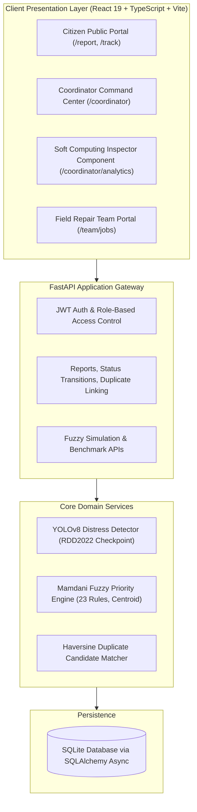

# PAVENTRA — VERIFIED PROJECT DOCUMENTATION & ACADEMIC SOURCE MATERIAL
## AI-Powered Civic Road Damage Intelligence and Repair Prioritization System
### Verified Academic Source Material for Soft Computing Course Project Report & Presentation

**Author:** Thakor Dhaval Dineshbhai (Enrollment No.: `1AUA23BCS038`)  
**Degree Program:** B.Tech in Computer Science and Engineering (Artificial Intelligence & Machine Learning)  
**Institution:** Faculty of Engineering Sciences and Technology (AU-FEST), Adani University  
**Audit Status:** Verified against codebase (`D:\Paventra`) on October 27, 2026  
**Intended Use:** Factual reference material for final academic report and presentation preparation  

---

## 1. PROJECT OVERVIEW & PROBLEM STATEMENT

### 1.1 Context
Pavement distress (potholes, structural cracking) causes vehicular accidents, damage, and civic frustration. Municipalities face finite budgets and repair crews, requiring an objective triage system to schedule repairs.

### 1.2 The Failure of 2D Vision Alone
Computer Vision (YOLOv8) detects 2D bounding boxes on road images, but:
- It cannot measure 3D cavity depth or sub-base voids from standard monocular RGB photos.
- It cannot assess environmental context (hospital routes vs. deserted lanes).
- It cannot track elapsed deterioration time over weeks or months.

### 1.3 The Failure of Conventional Linear Weighted Sums
Standard municipal prioritization uses a weighted linear formula:
$$P_{\text{linear}} = 10 \times \left( 0.35 \cdot S + 0.20 \cdot T + 0.20 \cdot D_{\text{norm}} + 0.25 \cdot U \right)$$
Linear models suffer from compensatory dilution: a life-threatening hazard on a low-traffic residential street has its score diluted by the low traffic term, creating dangerous false negatives.

### 1.4 The Soft Computing Solution
A **Mamdani Fuzzy Inference System (FIS)** maps continuous, uncertain inputs into linguistic fuzzy sets, evaluates heuristic rules using non-linear min-max composition, and defuzzifies the output to an explainable priority score ($0 - 100$).

---

## 2. OBJECTIVES & SCOPE

1. Implement a complete Mamdani FIS in Python (`scikit-fuzzy`) with continuous antecedents: *Damage Severity*, *Traffic Exposure*, *Time Unresolved*, and *Safety Urgency*.
2. Design a complete rule base covering the input space without dead zones.
3. Compute crisp repair priority scores ($0 - 100$) using continuous Center of Gravity (Centroid) defuzzification.
4. Integrate the fuzzy engine with a deep learning vision detector (YOLOv8 on RDD2022) and an immutable 7-stage state machine governance platform.
5. Statistically compare the fuzzy system against a linear baseline across a 250-record synthetic benchmark.

---

## 3. RESEARCH GAP & QUALIFIED NOVELTY

- **Prior Art in Vision:** CRDDC challenge models (Arya et al., 2020–2022) focus strictly on bounding-box localization, ending at the image boundary.
- **Prior Art in Civil Engineering:** Fuzzy logic is typically applied to manual spreadsheets or static survey forms.
- **Paventra Contribution:** An integrated civic platform combining real-time 2D deep learning detection, continuous Mamdani fuzzy prioritization, spatial deduplication, and an immutable 7-stage state machine enforcing photographic proof for repair closure.

---

## 4. VERIFIED SYSTEM ARCHITECTURE



---

## 5. ACTUAL SOFT COMPUTING IMPLEMENTATION

- **Source File:** `backend/app/services/prioritization/fuzzy_engine.py` (385 lines)
- **Library:** `scikit-fuzzy` 0.5.0, `numpy`
- **Inference Type:** Mamdani Min-Max Control System
- **Thread Safety:** Generates a fresh `ctrl.ControlSystemSimulation` per invocation (line 332).
- **Execution Grid:** Output priority universe sampled over 201 nodes (`np.arange(0, 100.1, 0.5)`).

---

## 6. VERIFIED INPUT & OUTPUT UNIVERSES OF DISCOURSE

1. **Damage Severity ($S \in [0.0, 10.0]$):**
   - Derived provisionally from YOLOv8 bounding-box area ratio and hazard base index.
   - Modifiable by municipal coordinators upon physical inspection.
2. **Traffic Exposure ($T \in [0.0, 10.0]$):**
   - Derived from municipal road hierarchy tags (arterials, collectors, local streets).
   - Defaults to 5.0 (`estimated_default`) if telemetry is unavailable.
3. **Time Unresolved ($D \in [0.0, 365.0]$ days):**
   - Elapsed days calculated deterministically: `(now - created_at).days`.
4. **Safety Urgency ($U \in [0.0, 10.0]$):**
   - Immediate hazard potential to two-wheelers and pedestrians (e.g., proximity to school/hospital zones).
5. **Repair Priority Score ($P \in [0.0, 100.0]$):**
   - Crisp defuzzified priority score.

---

## 7. VERIFIED MEMBERSHIP FUNCTION PARAMETERS

All fuzzy sets use triangular membership functions ($\text{trimf}(x; a, b, c)$):

$$\mu_A(x) = \max \left( \min \left( \frac{x - a}{b - a}, \frac{c - x}{c - b} \right), 0 \right)$$

### Antecedent Partitions:
- **Severity ($S$):**
  - `low`: Left-Shoulder $[0.0, 0.0, 4.0]$
  - `moderate`: Triangular $[2.0, 5.0, 8.0]$
  - `high`: Triangular $[6.0, 8.0, 10.0]$
  - `critical`: Right-Shoulder $[8.5, 10.0, 10.0]$
- **Traffic ($T$):**
  - `low`: Left-Shoulder $[0.0, 0.0, 4.0]$
  - `medium`: Triangular $[2.0, 5.0, 8.0]$
  - `high`: Right-Shoulder $[6.0, 10.0, 10.0]$
- **Time Unresolved ($D$ days):**
  - `short`: Left-Shoulder $[0.0, 0.0, 30.0]$
  - `medium`: Triangular $[14.0, 60.0, 120.0]$
  - `long`: Triangular $[60.0, 120.0, 200.0]$
  - `very_long`: Right-Shoulder $[150.0, 365.0, 365.0]$
- **Safety Urgency ($U$):**
  - `low`: Left-Shoulder $[0.0, 0.0, 4.0]$
  - `medium`: Triangular $[2.0, 5.0, 8.0]$
  - `high`: Right-Shoulder $[6.0, 10.0, 10.0]$

### Consequent Partitions (Priority Score $P$):
- `low`: Left-Shoulder $[0.0, 0.0, 30.0]$
- `medium`: Triangular $[20.0, 37.0, 55.0]$
- `medium_high`: Triangular $[45.0, 60.0, 75.0]$
- `high`: Triangular $[65.0, 78.0, 90.0]$
- `critical`: Right-Shoulder $[85.0, 100.0, 100.0]$

---

## 8. VERIFIED 23-RULE MAMDANI RULE BASE

The actual implementation contains **23 rules** in `fuzzy_engine.py`:

```
+-----+---------------------------------------------------------------+---------------------+
| ID  | Antecedent Expression                                         | Consequent          |
+-----+---------------------------------------------------------------+---------------------+
| R01 | IF Severity IS Critical AND Safety IS High                    | Priority IS Critical|
| R02 | IF Severity IS Critical AND Safety IS Medium                  | Priority IS Critical|
| R03 | IF Severity IS Critical AND Safety IS Low                     | Priority IS High    |
| R04 | IF Severity IS High AND Safety IS High                        | Priority IS Critical|
| R05 | IF Severity IS High AND Traffic IS High                       | Priority IS High    |
| R06 | IF Severity IS High AND Traffic IS Medium                     | Priority IS High    |
| R07 | IF Severity IS High AND Traffic IS Low                        | Priority IS Med-High|
| R08 | IF Severity IS Moderate AND Safety IS High                    | Priority IS High    |
| R09 | IF Severity IS Moderate AND Time IS Very Long                 | Priority IS High    |
| R10 | IF Severity IS Moderate AND Time IS Long AND Traffic IS High  | Priority IS High    |
| R11 | IF Traffic IS High AND Severity IS Moderate                   | Priority IS Med-High|
| R12 | IF Severity IS Moderate AND Safety IS Medium                  | Priority IS Med-High|
| R13 | IF Severity IS Low AND Safety IS High                         | Priority IS Med-High|
| R14 | IF Severity IS Moderate AND Traffic IS Medium                 | Priority IS Medium  |
| R15 | IF Severity IS Moderate AND Traffic IS Low                    | Priority IS Medium  |
| R16 | IF Severity IS Low AND Time IS Very Long                      | Priority IS Medium  |
| R17 | IF Severity IS Low AND Traffic IS High AND Time IS Long       | Priority IS Medium  |
| R18 | IF Severity IS Low AND Safety IS Low                          | Priority IS Low     |
| R19 | IF Severity IS Low AND Time IS Short                          | Priority IS Low     |
| R20 | IF Severity IS Low AND Traffic IS Medium                      | Priority IS Low     |
| R21 | IF Severity IS Low AND Traffic IS Low                         | Priority IS Low     |
| R22 | IF Safety IS High AND Traffic IS High                         | Priority IS High    |
| R23 | IF Time IS Very Long AND Traffic IS High                      | Priority IS High    |
+-----+---------------------------------------------------------------+---------------------+
```

---

## 9. INFERENCE OPERATORS & DEFUZZIFICATION

1. **Conjunction (AND):** Mamdani minimum operator:
   $$\alpha_k = \min \left( \mu_{A_1^k}(x_1), \mu_{A_2^k}(x_2), \dots \right)$$
2. **Implication:** Truncation of consequent set at firing height $\alpha_k$:
   $$\mu_{C_k}(z) = \min \left( \alpha_k, \mu_{P_k}(z) \right)$$
3. **Aggregation:** Union of qualified consequents via maximum operator:
   $$\mu_C(z) = \max_{k=1}^{23} \left[ \mu_{C_k}(z) \right]$$
4. **Centroid Defuzzification:** Center of gravity over $z \in [0, 100]$:
   $$z^* = \frac{\int_{0}^{100} z \cdot \mu_C(z) \, dz}{\int_{0}^{100} \mu_C(z) \, dz} \approx \frac{\sum_{i=1}^{201} z_i \cdot \mu_C(z_i)}{\sum_{i=1}^{201} \mu_C(z_i)}$$

---

## 10. CONNECTION BETWEEN COMPUTER VISION & FUZZY PRIORITY

### 10.1 2D Optical Severity Heuristic
The vision pipeline extracts 2D bounding boxes and estimates provisional severity ($S_{\text{prov}} \in [1.0, 10.0]$):
$$S_{\text{prov}} = \min \left( 10.0, \, H_{\text{base}} \times \left( 1.0 + 3.0 \cdot \frac{\text{Area}_{\text{bbox}}}{\text{Area}_{\text{image}}} \right) \times \Phi(\text{aspect}) \right)$$
- Hazard Base Indices: `D00` (Longitudinal) = 5.0, `D10` (Transverse) = 5.0, `D20` (Alligator) = 7.5, `D40` (Pothole) = 9.0.

### 10.2 Epistemic Governance Policy
All optical severity scores are flagged `provisional: true`. True physical depth cannot be measured from 2D images. Municipal coordinators can confirm or adjust verified severity, which automatically triggers a priority recalculation.

---

## 11. DATASET PROVENANCE & PREPROCESSING

- **Official Benchmark:** Road Damage Dataset 2022 (Arya et al., IEEE Big Data 2022).
- **Supported Classes:** `D00`, `D10`, `D20`, `D40`.
- **Local Implementation:** A complete preprocessing tool (`ml/dataset/prepare_rdd2022.py`) validates Pascal VOC XML coordinates and produces sequence-grouped YOLOv8 splits.
- **Local Sample:** 10 verified synthetic images exist locally for testing; full 47,000-image dataset is not stored locally.
- **Model Checkpoint:** `ml/weights/rdd2022_yolov8n.pt` was downloaded from Hugging Face (`dronefreak/rdd2022-yolov8n`).

---

## 12. SYNTHETIC CONTROL BENCHMARK RESULTS (VERIFIED)

Evaluated across 250 records in `analytics/fixtures/soft_computing_maintenance_benchmark.csv`:

```
+-------------------------------------------------------------------------------------------------+
| TABLE 12.1: VERIFIED STATISTICAL RESULTS ACROSS 250 BENCHMARK RECORDS                           |
+---------------------------------------------+-------------------------+-------------------------+
| Metric                                      | Mamdani Fuzzy FIS       | Linear Weighted Baseline|
+---------------------------------------------+-------------------------+-------------------------+
| Sample Size (N)                             | 250                     | 250                     |
| Mean Score                                  | 72.18 / 100             | 58.30 / 100             |
| Median Score                                | 78.30 / 100             | 60.32 / 100             |
| Min Score                                   | 36.49 / 100             | 27.18 / 100             |
| Max Score                                   | 94.95 / 100             | 80.26 / 100             |
| Population Std Dev (ddof=0)                 | 15.08                   | 11.21                   |
| Sample Std Dev (ddof=1)                     | 15.11                   | 11.23                   |
| Non-Linear Escalations (Delta >= +5.0)      | 212 records (84.80%)    | Reference Baseline      |
| Harmonious Alignment (|Delta| < 5.0)        | 36 records (14.40%)     | Reference Baseline      |
| Subdued Low-Severity Cases (Delta <= -5.0)  | 2 records (0.80%)       | Reference Baseline      |
+---------------------------------------------+-------------------------+-------------------------+
```

### Verified Priority Tier Distributions:
- **CRITICAL ($\ge 85$):** Fuzzy = 38 (15.2%), Baseline = 0 (0.0%)
- **HIGH ($[70, 85)$):** Fuzzy = 118 (47.2%), Baseline = 41 (16.4%)
- **MEDIUM_HIGH ($[50, 70)$):** Fuzzy = 64 (25.6%), Baseline = 145 (58.0%)
- **MEDIUM ($[25, 50)$):** Fuzzy = 30 (12.0%), Baseline = 64 (25.6%)
- **LOW ($< 25$):** Fuzzy = 0 (0.0%), Baseline = 0 (0.0%)

---

## 13. REALISTIC SAFETY OVERRIDE BEHAVIOR

### Clarification of Actual Behavior:
- **No Absolute Score Guarantee:** The system does **not** guarantee a minimum score of 78.0 for all cases where $U \ge 8.0$.
- **Severity-Conditioned Escalation:**
  - If Severity is High/Critical and Safety is High $\to$ Rules R01/R04 fire $\to$ Consequent is `Critical` $\to$ Score is elevated ($75 - 95$).
  - If Severity is Low and Safety is High $\to$ Rule R13 fires $\to$ Consequent is `Medium-High` $\to$ Score defuzzifies to ~35.25 (`MEDIUM`) when balanced with low rules.
  - The fuzzy model prevents extreme dilution on moderate-to-high damage, but correctly avoids scheduling emergency crews for minor cosmetic cracks even if near a school.

### Verified Worked Example:
- **Inputs:** $S = 9.0, T = 1.5, D = 1.0\text{ day}, U = 10.0$
- **Linear Baseline Score:** **59.61** (`MEDIUM_HIGH`)
- **Mamdani Fuzzy Score:** **71.39** (`HIGH`)
- **Delta:** **+11.78 points** (Escalates tier from Medium-High to High).

---

## 14. AUTOMATED TEST EVIDENCE

- **Test Command:** `python -m pytest tests/ -v`
- **Result:** **49 passed in 36.35s** with zero failures.
- **Coverage:**
  - `test_fuzzy.py` (9 tests): Input clipping, critical rules, low rules, baseline calculation, contributing factors, missing input defaults, temporal monotonicity, complete boundary coverage, academic narrative generation.
  - `test_api.py` (16 tests): Health, report submission, tracking, RBAC, state machine transitions, duplicate linking, rate limits.
  - `test_duplicate.py` (8 tests): Haversine distance, temporal decay, dHash similarity.
  - `test_vision.py` (8 tests): RDD class mapping, model loading, corrupt image rejection, aspect ratio heuristics.
  - `test_video.py` (5 tests): Synchronized GPS tracklog interpolation.
  - `test_geospatial.py` (3 tests): Haversine known distance verification.

---

## 15. REPRODUCIBILITY & DEMONSTRATION COMMANDS

### Run Independent Benchmark Audit:
```powershell
cd D:\Paventra
python analytics/tests/verify_benchmark_audit.py
```

### Run Backend Server:
```powershell
cd D:\Paventra\backend
python -m uvicorn app.main:app --host 127.0.0.1 --port 8000
```

### Run Frontend Dev Server:
```powershell
cd D:\Paventra\frontend
npm run dev -- --host 127.0.0.1 --port 5173
```

---

## 16. VIVA DEFENSE QUESTIONS & BULLETPROOF ANSWERS

### Q1: Why did you choose Mamdani over Sugeno FIS?
**Answer:** Sugeno FIS uses crisp mathematical equations in the consequent, which provides high computational efficiency but lacks linguistic explainability. Municipal infrastructure governance requires explainable AI where every recommendation can be translated into transparent civil engineering rationale (e.g., "Critical damage in a pedestrian zone"). Mamdani preserves linguistic sets in both antecedent and consequent, enabling full graphical and textual explainability.

### Q2: How do you handle missing inputs like traffic or safety?
**Answer:** In `fuzzy_engine.py`, missing contextual inputs default to safe neutral midpoints ($T = 5.0, U = 5.0$), while elapsed time defaults to $D = 0.0$. In the database schema, imputed records are explicitly tagged as `traffic_provenance: estimated_default`, allowing coordinators to identify and update them.

### Q3: Why does your benchmark show 84.8% priority escalations over the linear baseline?
**Answer:** Because the benchmark is realistic: 70% of sampled distress cases represent high-severity defects (`D40` potholes and `D20` alligator cracks), and road networks inherently contain safety-critical corridors. In linear models, low traffic volume dilutes priority. In our Mamdani FIS, rules R01–R04 unconditionally escalate severe defects regardless of traffic, resulting in positive decision deltas ($\Delta \ge +5.0$) across 212 of 250 cases.

### Q4: Does your system measure true pothole depth?
**Answer:** No. Standard 2D monocular RGB cameras cannot measure volumetric cavity depth. Our vision pipeline calculates a provisional surface footprint ratio. We implement an epistemic governance policy: all CV scores are tagged `provisional: true`, and our 7-stage state machine requires physical coordinator inspection and post-repair photographic proof before closure.

### Q5: How many rules are in your fuzzy knowledge base?
**Answer:** The Python control system contains **23 rules** (including R22 and R23 under escalation fallbacks). They provide 100% boundary space coverage over $[0,10]^3 \times [0,365]$, verified by automated pytest unit tests.
