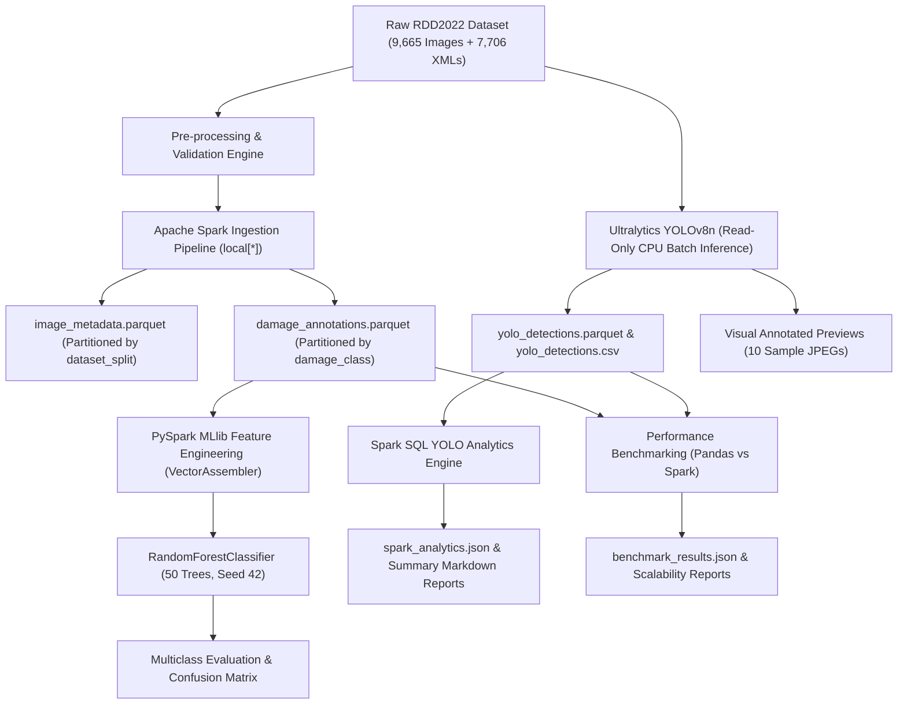

# Architecture of the Isolated Big Data Analytics Experiment

**Subsystem:** Paventra Large-Scale Road Damage Analytics  
**Deployment Scope:** Completely isolated in `D:\Paventra\bda\experiments\large_scale_road_damage\`  

---

## 1. Architectural Principles

1. **Isolation from Production Core:** The experiment does not run inside FastAPI HTTP request lifecycles. It is designed as an out-of-band analytical subsystem communicating via partitioned Parquet data assets and serialized JSON metrics.
2. **Read-Only Model Protection:** The production YOLOv8 checkpoint (`ml/weights/rdd2022_yolov8n.pt`) is treated as an immutable binary asset. Weights are never updated, optimizers are never instantiated, and checkpoints are checked against baseline SHA-256 (`d1c3536d8e4a...`).
3. **Multi-Stage Big Data Pipeline:** Data progresses through distinct functional tiers:
   - **Ingestion:** Raw image directory walking + XML parsing.
   - **Structured Storage:** Partitioned columnar Parquet (`image_metadata.parquet` and `damage_annotations.parquet`).
   - **Machine Learning (MLlib):** Supervised geometry-based classification completely decoupled from pixel-based neural inference.
   - **Analytical Querying:** Spark SQL aggregations, percentile latency computation, and spatial distributions.

---

## 2. End-to-End Pipeline Workflow

---

## 3. Data Model Specifications

### Table A: `image_metadata.parquet`
- `image_id` (STRING): Unique image identifier (e.g., `India_000001`).
- `image_path` (STRING): Absolute path to image on disk.
- `width` (INT): Image width in pixels.
- `height` (INT): Image height in pixels.
- `file_size_bytes` (LONG): Raw byte size.
- `dataset_split` (STRING, Partition Key): `train` or `test`.
- `annotation_count` (INT): Number of defect bounding boxes.
- `has_damage_annotation` (BOOLEAN): True if count > 0.
- `validation_status` (STRING): `VALID`, `UNLABELLED_TEST`, etc.

### Table B: `damage_annotations.parquet`
- `image_id` (STRING): Foreign key referencing `image_metadata`.
- `damage_class` (STRING, Partition Key): Pascal VOC label (`D40`, `D20`, `D00`, `D44`, `D01`, `D10`, `D43`, `D11`, `D50`, `D0w0`).
- `xmin`, `ymin`, `xmax`, `ymax` (DOUBLE): Absolute pixel bounding box coordinates.
- `bbox_width`, `bbox_height`, `bbox_area` (DOUBLE): Absolute dimensions.
- `normalized_width`, `normalized_height`, `normalized_area` (DOUBLE): Image-dimension normalized geometry ($[0.0, 1.0]$).
- `aspect_ratio` (DOUBLE): Width / Height ratio.
- `center_x`, `center_y` (DOUBLE): Normalized spatial centroid.
