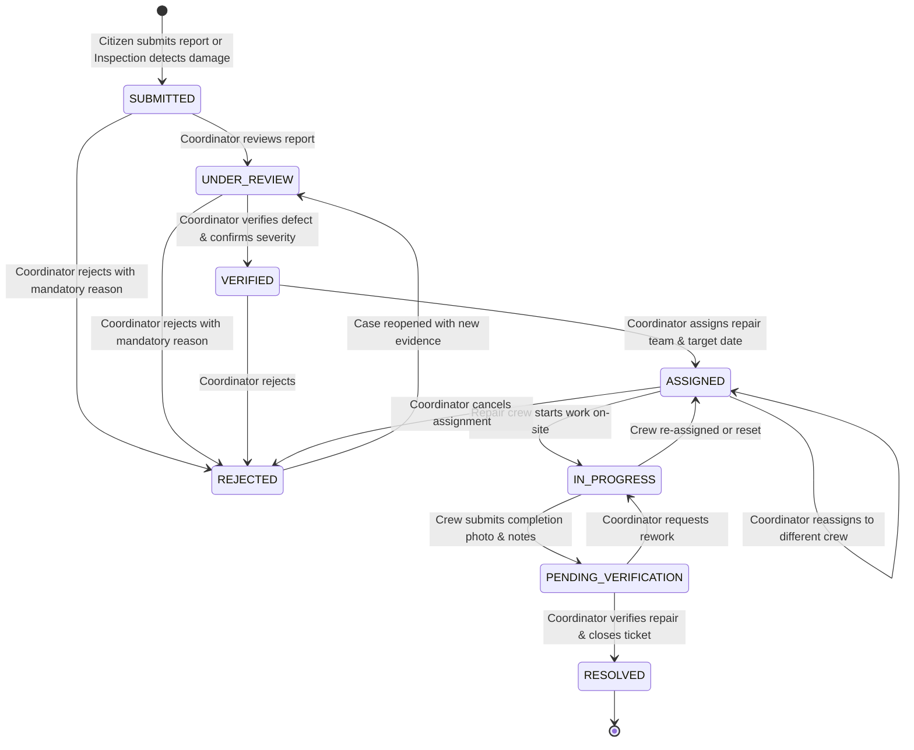
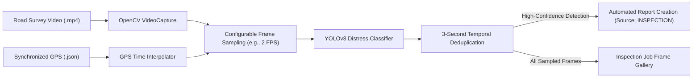

# Paventra — System Architecture & Technical Specification

## 1. Architectural Overview

Paventra is an end-to-end civic road intelligence and repair operations platform designed with a clean separation of concerns across presentation, API routing, business domain services, persistence, and batch analytics.

```mermaid
flowchart TD
    subgraph Client ["Client Presentation (React 19 + TypeScript + Vite)"]
        CitizenPortal["Citizen Portal (/report, /track, /my-reports, /register)"]
        CoordDashboard["Coordinator Command Center (/coordinator/*)"]
        RepairPortal["Repair Operations Portal (/team/jobs)"]
        LeafletMap["Interactive Leaflet OpenStreetMap Engine"]
        SSEListener["SSE Notification Listener (/api/v1/notifications/stream)"]
    end

    subgraph API ["FastAPI Application Gateway"]
        AuthRouter["/api/v1/auth (Login, Register, Me)"]
        ReportsRouter["/api/v1/reports (CRUD, Status, Assign, Evidence, Duplicates)"]
        InspectionsRouter["/api/v1/inspections (Upload, GPS track, Sample frames)"]
        TeamsRouter["/api/v1/teams (Teams, Assigned jobs, Work commencement)"]
        AnalyticsRouter["/api/v1/analytics (KPI summary, 90-day trends)"]
        NotifRouter["/api/v1/notifications (Alerts & SSE stream)"]
        AuditRouter["/api/v1/audit (Report audit timeline)"]
    end

    subgraph Services ["Domain Service Layer"]
        CVService["YOLOv8 Inference Engine / Honest Offline Fallback"]
        VideoService["OpenCV Frame Extractor & 3s Temporal Deduplication"]
        GeoService["Haversine Spatial Validator & GPS Track Interpolator"]
        FuzzyService["scikit-fuzzy Priority Engine & Contributor Analysis"]
        DupService["Composite Duplicate Candidate Matcher"]
        AuditService["Immutable Audit Trail & Notification Dispatcher"]
    end

    subgraph Storage ["Persistence & Filesystem"]
        DB[(SQLAlchemy Async / SQLite or PostgreSQL PostGIS)]
        MediaStorage[Local Media Store (/uploads/reports, /uploads/inspections)]
    end

    subgraph BigData ["Batch Analytics & ML Offline Layer"]
        BatchJob["PySpark / Pandas Hotspot Clustering & Parity Validator"]
    end

    CitizenPortal --> API
    CoordDashboard --> API
    RepairPortal --> API
    SSEListener <--> NotifRouter
    API --> Services
    Services --> DB
    Services --> MediaStorage
    BatchJob --> DB
```

---

## 2. Multi-Role Permissions & Access Control

Paventra enforces strict role-based access control (RBAC) at the API boundary using cryptographically signed JSON Web Tokens (JWT) and direct bcrypt password hashing:

| Role | Accessible Routes / Actions | Permitted Status Transitions |
|---|---|---|
| **Citizen (Public / Registered)** | Submit report (`POST /reports`), view public tracking (`GET /reports/track/{ref}`), submit supplemental evidence (`POST /reports/track/{ref}/evidence`), view own submissions (`GET /reports/my`). Cannot access coordinator views. | `SUBMITTED` (initial creation only) |
| **Repair Team** | View assigned jobs (`GET /teams/my-jobs`), commence on-site work (`POST /teams/jobs/{id}/start`), submit completion evidence photos and notes (`POST /reports/{id}/completion`). | `ASSIGNED` $\rightarrow$ `IN_PROGRESS`<br>`IN_PROGRESS` $\rightarrow$ `PENDING_VERIFICATION` |
| **Municipal Coordinator** | Triage, verify, reject, assign/reassign repair teams, adjust verified severity, trigger priority recalculations, review duplicate candidates, confirm resolution, view operational analytics. | `SUBMITTED` $\rightarrow$ `UNDER_REVIEW` / `REJECTED`<br>`UNDER_REVIEW` $\rightarrow$ `VERIFIED` / `REJECTED`<br>`VERIFIED` $\rightarrow$ `ASSIGNED` / `REJECTED`<br>`ASSIGNED` $\rightarrow$ `ASSIGNED` (Reassign) / `REJECTED`<br>`PENDING_VERIFICATION` $\rightarrow$ `RESOLVED` / `IN_PROGRESS` (Rework)<br>`REJECTED` $\rightarrow$ `UNDER_REVIEW` (Reopen) |
| **Admin** | Superuser access to all system endpoints, user administration, and system maintenance. | All transitions |

---

## 3. Strict State Machine Lifecycle

Report statuses transition through an explicit finite state machine. Any unauthorized or invalid transition attempt is rejected by the backend with HTTP 400/403.



---

## 4. Method B Automated Video Inspection Pipeline

Method B ingests vehicular survey video files along with synchronized time-stamped GPS track logs:



### Key Technical Details:
1. **GPS Time-Interpolation:** Each GPS log entry contains `{"time_offset_sec": float, "latitude": float, "longitude": float}`. When a frame is extracted at timestamp $T$, the service interpolates between the two nearest bounding GPS coordinates.
2. **Temporal Deduplication:** Road distress visible over several consecutive frames is suppressed if a detection of the same damage class occurred within 3 seconds, preventing ticket flooding.
3. **Traceability:** Automated reports reference the `inspection_frame_id` and retain the annotated bounding box image.

---

## 5. Explainable Fuzzy Priority Engine

Paventra utilizes a Mamdani fuzzy inference system implemented with `scikit-fuzzy`:

### Fuzzy Variables & Membership Sets:
- **`severity`** ($0 - 10$): `minor` (triangular [0, 0, 4]), `moderate` (triangular [2, 5, 8]), `severe` (triangular [6, 10, 10]).
- **`traffic_exposure`** ($0 - 10$): `low` (triangular [0, 0, 4]), `medium` (triangular [2, 5, 8]), `high` (triangular [6, 10, 10]).
- **`time_unresolved_days`** ($0 - 365$): `recent` (triangular [0, 0, 14]), `aging` (triangular [7, 30, 90]), `critical` (triangular [60, 365, 365]).
- **`safety_urgency`** ($0 - 10$): `routine` (triangular [0, 0, 4]), `elevated` (triangular [2, 5, 8]), `urgent` (triangular [6, 10, 10]).
- **Output `priority_score`** ($0 - 100$): Defuzzified using the **centroid method**.

### Priority Classes:
- `CRITICAL`: Priority $\ge 85$
- `HIGH`: $70 \le \text{Priority} < 85$
- `MEDIUM_HIGH`: $50 \le \text{Priority} < 70$
- `MEDIUM`: $25 \le \text{Priority} < 50$
- `LOW`: $\text{Priority} < 25$

### Baseline Comparison Model:
A linear baseline reference is computed alongside the fuzzy output:
$$S_{baseline} = 10 \times (0.35 \times s + 0.20 \times t_{traffic} + 0.20 \times \min(10, \frac{\text{days}}{7}) + 0.25 \times u)$$
The system logs the baseline score and delta, enabling audits of the non-linear fuzzy control rules.

---

## 6. Duplicate Candidate Detection Engine

To prevent redundant dispatch of repair teams, Paventra computes a composite similarity index for complaints within spatial proximity:

$$S_{composite} = 0.50 \cdot S_{geo} + 0.25 \cdot S_{time} + 0.25 \cdot S_{type}$$

1. **Geographic Proximity ($S_{geo}$):** Computed via the Haversine formula. Scores $1.0$ at distance $0\text{ m}$, decaying linearly to $0.0$ at the search threshold ($100\text{ m}$).
2. **Temporal Proximity ($S_{time}$):** Decays over time (identical day $= 1.0$, within 30 days $> 0$).
3. **Damage Type Match ($S_{type}$):** $1.0$ for identical damage classes, $0.5$ for related distress (e.g. longitudinal crack vs alligator crack), $0.0$ otherwise.
4. **Coordinator Review & Linking:** Matches scoring above $0.60$ are surfaced in the Coordinator Report Detail view for manual review. If confirmed, a bilateral `DuplicateLink` is created and the secondary report is marked as a duplicate.

---

## 7. Media & Evidence Architecture

- **Primary Evidence:** Citizen or vehicle camera photo uploaded upon report creation.
- **Supplemental Evidence:** Citizens can upload additional photos to an existing report (`MediaAsset.context = "supplemental"`).
- **Completion Evidence:** Repair teams upload after-repair photos (`MediaAsset.context = "completion"`) alongside work order notes.
- **Annotated Overlays:** For detections generated by YOLOv8, an annotated overlay image showing bounding boxes is stored alongside the raw image (`MediaAsset.context = "annotation"`).
- All media assets are stored safely on disk with secure random filenames (`uploads/reports/{uuid}_{filename}`) and served statically through FastAPI.

---

## 8. Big Data Batch Analytics Architecture

The analytics layer (`analytics/jobs/road_damage_batch_analytics.py`) processes historical and operational complaint records:
1. **Spatial Grid Clustering:** Truncates coordinates to $0.01^\circ$ (approx. $1.1\text{ km}$) to cluster recurring road distress hotspots.
2. **Turnaround Metric Computation:** Aggregates mean and median time from `SUBMITTED` to `RESOLVED` by district and team.
3. **Method Distribution:** Analyzes ratio of citizen-reported vs. automatically detected defects.
4. **Validation Parity Check:** Runs computations through both Apache PySpark and a reference Pandas engine, validating that calculated means, sums, and counts are identical within an epsilon threshold ($10^{-5}$).
