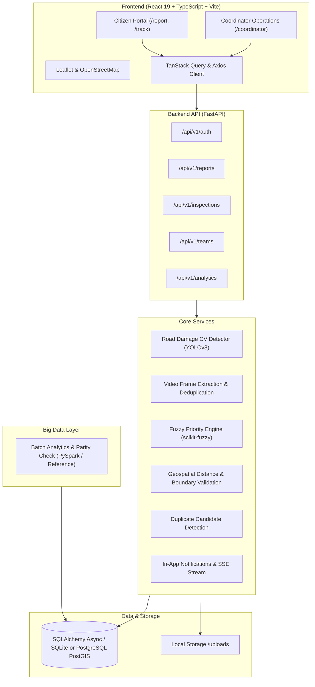
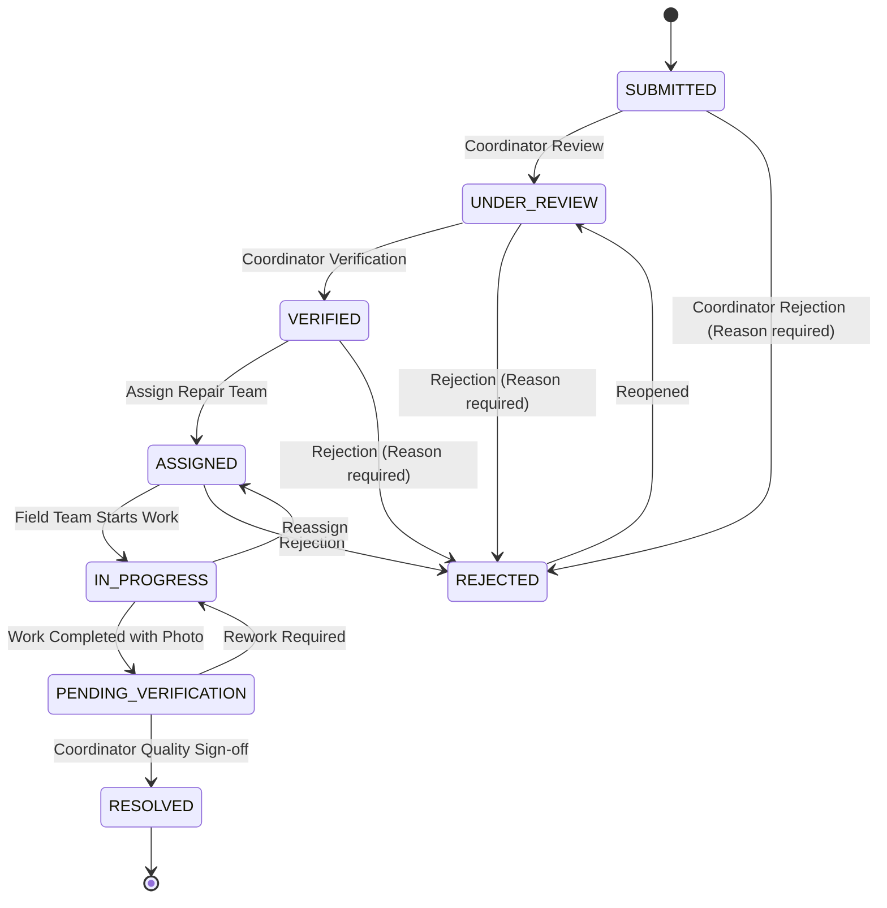

# Paventra — Architecture & Technical Reference

## 1. System Architecture Overview

Paventra is an end-to-end civic road intelligence and repair management platform built with a modular, maintainable full-stack architecture.

---

## 2. Domain Entities & Database Schema

The relational schema is defined with explicit foreign keys, indexes, timestamps, and status transition constraints:
- **`User`**: Municipal coordinators, citizens, repair teams, and administrators.
- **`Report`**: Core road damage record tracking source (`citizen` vs. `inspection`), status, coordinates, location provenance, AI predictions, and fuzzy priority.
- **`MediaAsset`**: Stored image/video file metadata, MIME types, and annotated overlays.
- **`ReportStatusHistory`**: Complete state transition audit log with actor ID, reason, and notes.
- **`RepairTeam` & `RepairAssignment`**: Field repair crew assignment, scheduled target dates, and after-repair verification.
- **`FuzzyPriorityAssessment`**: Inputs (`severity`, `traffic`, `time`, `safety`), defuzzified priority score (0-100), label, and explainable top contributing factors.
- **`DuplicateLink`**: Tracks candidate and verified duplicate pairs with distance and composite similarity score.
- **`InspectionJob` & `InspectionFrame`**: Automated video discovery jobs, sampled frames, detection lists, and temporal deduplication flags.
- **`AuditEvent`**: Tracks all sensitive administrative mutations.
- **`Notification`**: Real-time persisted in-app alerts and Server-Sent Events (SSE).

---

## 3. Strict State Transition Finite State Machine

---

## 4. Fuzzy Priority Engine Specification
Implemented with `scikit-fuzzy` control systems:
- **Inputs**:
  - `severity`: [0, 10] (Damage magnitude)
  - `traffic_exposure`: [0, 10] (Road volume / classification)
  - `time_unresolved_days`: [0, 365] (Duration pending repair)
  - `safety_urgency`: [0, 10] (Immediate hazard to motorists/pedestrians)
- **Output**:
  - `priority_score`: [0, 100] defuzzified via centroid method
- **Priority Labels**:
  - `CRITICAL` ($\ge 85$)
  - `HIGH` ($70 - 85$)
  - `MEDIUM_HIGH` ($50 - 70$)
  - `MEDIUM` ($25 - 50$)
  - `LOW` ($< 25$)
- **Explainability**: Outputs the top contributing factors with impact weights.
- **Baseline Comparison**: Compares against a deterministic weighted linear model $S_{baseline} = 10 \times (0.35 s + 0.20 t_{raf} + 0.20 t_{ime} + 0.25 u)$.
