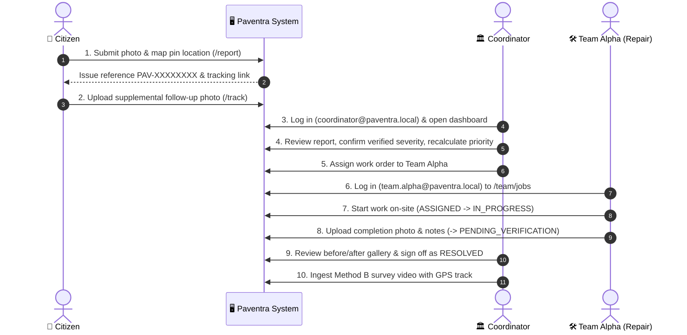

# Paventra — End-to-End Demonstration Walkthrough Script

This walkthrough demonstrates the complete Paventra platform across its three user roles: **Citizen**, **Municipal Coordinator**, and **Repair Team Field Crew**, as well as the **Method B Automated Video Inspection** pipeline and **Fuzzy Priority Engine**.

---

## ⚡ Prerequisites & Server Verification

Ensure both servers are running:

### 1. Backend API (FastAPI)
```powershell
cd d:\Paventra\backend
python -m uvicorn app.main:app --host 127.0.0.1 --port 8000
```
- Verify health: `http://127.0.0.1:8000/api/health` $\rightarrow$ `{"status":"ok","version":"1.0.0"}`
- Interactive API Docs: `http://127.0.0.1:8000/docs`

### 2. Frontend Web Application (React + Vite)
```powershell
cd d:\Paventra\frontend
npm run dev
```
- Open browser at: `http://localhost:5173`

---

## 🧭 Demonstration Storyline (5–7 Minutes)



---

## Act 1: Citizen Reporting & Live Tracking (Method A)

1. **Submit a New Report:**
   - Open browser at `http://localhost:5173/report`.
   - Notice the mobile-responsive civic design system (clear contrast, no decorative AI gradients).
   - In Step 1 (**Capture Evidence**), select an image of a road defect (or take a photo).
   - Select damage category `Pothole` and enter description: *"Severe pothole near pedestrian crossing"*.
   - Click **Next: Confirm location**.
   - In Step 2 (**Location**), click anywhere on the Leaflet OpenStreetMap to position the pin (or use current geolocation).
   - Click **Review & Submit**.
   - Review details and click **Submit report**.

2. **Verify Submission & Reference Generation:**
   - The submission completes and returns a unique public reference (e.g., `PAV-9B41F02A`).
   - Notice the AI assessment: if YOLOv8 weights are active, bounding boxes appear; if offline, an honest, transparent offline notice is displayed without fabricating fake predictions.
   - Click **Track status**.

3. **Public Tracking & Supplemental Evidence:**
   - URL updates to `/track/PAV-XXXXXXXX`.
   - Observe the live timeline showing the report in `Submitted` status.
   - Expand the **Add supplemental evidence** card:
     - Select a follow-up photo.
     - Add a note: *"Measured depth is approx 8 cm; traffic slowing down"*.
     - Click **Upload evidence**.
     - The photo appears immediately under the evidence gallery.

4. **Citizen Self-Service Dashboard (Optional):**
   - Click **Sign in** $\rightarrow$ **Register** (`/register`).
   - Create a citizen account and navigate to `/my-reports` to view all submissions linked to your account.

---

## Act 2: Coordinator Triaging & Priority Engine

1. **Log in as Municipal Coordinator:**
   - Navigate to `http://localhost:5173/login`.
   - Enter credentials:
     - **Email:** `coordinator@paventra.local`
     - **Password:** `Paventra2024!`
   - You are redirected to `/coordinator`.

2. **Review Operational Dashboard:**
   - Observe genuine persisted KPI cards (Active Complaints, 7-Day Volume, Overdue Cases, Unverified High-Severity).
   - Inspect the daily intake trend line chart and status distribution bar chart.

3. **Triage the Report:**
   - Click **Reports** in the left navigation sidebar (`/coordinator/reports`).
   - Filter by status `submitted` or search by reference code.
   - Click on the newly submitted report to open `/coordinator/reports/{id}`.

4. **Multi-Asset Gallery & AI / Fuzzy Analysis:**
   - In the **Evidence Gallery**, observe both the original citizen photo and the supplemental photo tagged with context badges (`Primary`, `Supplemental`).
   - In the **Fuzzy Priority Assessment** card, observe:
     - Priority score (0–100) and priority badge (e.g., `HIGH`).
     - Breakdown of inputs: Severity, Traffic Exposure, Unresolved Duration, Safety Urgency.
     - Top contributing factors explaining why this defect received its score.
     - Deterministic baseline comparison score and calculated variance.

5. **State Transition & Verified Severity Confirmation:**
   - Under **Update report status**, select `Under Review` $\rightarrow$ click **Apply status change**.
   - Select `Verified`.
   - Notice the **Verified Severity (0–10)** confirmation input appears:
     - Enter `8.5` (confirming elevated severity) and reason: *"Confirmed critical arterial pothole"*.
     - Click **Apply status change**.
     - Notice the Priority Score automatically recalculates based on the confirmed severity!

6. **Duplicate Candidate Review & Linking:**
   - Scroll down to the **Duplicate candidates** card.
   - Paventra displays nearby complaints within 100 meters, showing distance, time difference, and composite similarity score.
   - If a duplicate candidate is present, click **Link as duplicate** to bilaterally link the records.

7. **Assign Repair Crew:**
   - Scroll to the **Assign repair team** section.
   - Select `Team Alpha (Pothole Rapid Response)`.
   - Set a target completion date (e.g., tomorrow).
   - Enter notes: *"Prioritize morning shift before peak traffic"*.
   - Click **Assign team**.
   - Report status transitions to `ASSIGNED`.
   - Scroll to the **Audit trail** card at the bottom to verify that every state transition, actor, and timestamp is permanently recorded.

---

## Act 3: Field Repair Team Operations Portal

1. **Log in as Repair Team Alpha:**
   - Open a private/incognito window (or log out) and navigate to `http://localhost:5173/login`.
   - Enter repair team credentials:
     - **Email:** `team.alpha@paventra.local`
     - **Password:** `TeamAlpha2024!`
   - Notice you are automatically redirected to the specialized portal: `/team/jobs`.

2. **Inspect Assigned Work Orders:**
   - The job assigned in Act 2 appears at the top with badge `ASSIGNED`.
   - The card displays target completion date, location coordinates, dispatch instructions, and the initial damage photograph.
   - Click **Navigate to site** to open external OpenStreetMap directions.

3. **Commence On-Site Work:**
   - Click **Start work on site**.
   - Status instantly updates to `IN_PROGRESS`.

4. **Submit Completion Evidence:**
   - Click **Submit completion evidence**.
   - Select a photo of the completed asphalt patch (`completion_photo.jpg`).
   - Enter completion notes: *"Filled with 50mm hot-mix asphalt and compacted to grade"*.
   - Click **Submit completion evidence**.
   - Work order moves to `PENDING_VERIFICATION`.

---

## Act 4: Coordinator Verification & Final Resolution

1. **Review as Coordinator:**
   - Switch back to the coordinator session and refresh the report detail page.
   - Status is now `PENDING_VERIFICATION`.
   - In the **Evidence Gallery**, click the **Completion Evidence** thumbnail to review the repair photo side-by-side with the initial defect.
   - In the **Audit Trail**, notice the repair crew's work start and completion timestamps are logged.

2. **Final Sign-off:**
   - Under **Update report status**, select `Resolved`.
   - Enter notes: *"Work inspected and approved for closure"*.
   - Click **Apply status change**.
   - Report status is now `RESOLVED`.
   - Return to the public tracking URL `/track/PAV-XXXXXXXX` $\rightarrow$ Notice the timeline now shows `Resolved` with full completion confirmation!

---

## Act 5: Method B Automated Road Video Ingestion

1. **Navigate to Video Inspections:**
   - In the coordinator sidebar, click **Inspections** (`/coordinator/inspections`).
   - Notice any existing inspection runs with status, frame count, and detection counts.

2. **Submit a New Video Survey Job:**
   - Click **New Video Inspection**.
   - Upload survey video file (e.g., `survey_drive_01.mp4`).
   - Upload synchronized GPS JSON tracklog (e.g., `gps_track_01.json`).
   - Select frame sample rate: `2 FPS`.
   - Click **Start processing**.

3. **Inspect Automated Detections & Reports:**
   - The job processes frames through OpenCV and YOLOv8 distress detection.
   - The 3-second temporal deduplicator groups continuous distress into distinct defects.
   - High-confidence detections automatically generate official reports with source `INSPECTION`.
   - Click **View frames** to inspect the extracted video frames and annotated bounding box detections.

---

## Act 6: Geospatial Map & Operational Analytics

1. **Interactive Geospatial Map:**
   - Click **Map** in the sidebar (`/coordinator/map`).
   - All active and resolved road defects appear with status-colored SVG markers.
   - Click any marker to open its pop-up summary (reference code, priority score, damage type, and a direct link to the report).

2. **Real-Time Notification Center & SSE Stream:**
   - Click **Notifications** in the sidebar (`/coordinator/notifications`).
   - Real-time alerts generated across status changes, assignments, and completions are displayed.
   - Click **Mark all read** to update all notifications.

3. **Operational Analytics:**
   - Click **Analytics** (`/coordinator/analytics`).
   - Review the status breakdown, severity distribution pie chart, and 90-day intake trend.

---

## Act 7: Big Data Batch Analytics & Test Suite Verification

### 1. PySpark & Pandas Batch Analytics
Open a PowerShell terminal and run:
```powershell
python d:\Paventra\analytics\jobs\road_damage_batch_analytics.py
```
**Expected Output:**
- Processes 150 synthetic damage records across spatial grids ($0.01^\circ$ precision).
- Computes mean turnaround duration, high-density defect clusters, and reporting source ratios.
- Confirms mathematical parity between PySpark and Reference engines:
  ```
  === VALIDATION: PARITY CHECK ===
  Max difference in metric values: 0.000000
  Parity verified: True
  ```

### 2. Full Automated Pytest Suite
Run the backend test suite:
```powershell
cd d:\Paventra\backend
python -m pytest -v
```
**Expected Output:**
- `21 passed in ~3.5s` verifying citizen uploads, state machine transitions, repair team workflow, verified severity recalculation, duplicate candidate matching, fuzzy logic control rules, and geospatial calculations.
